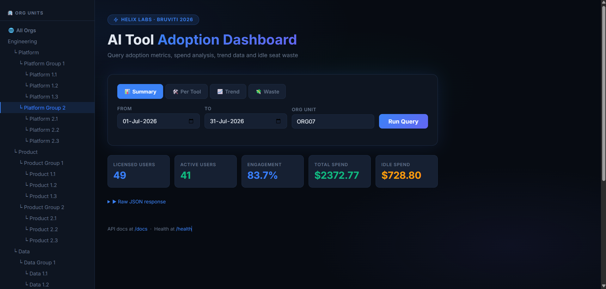
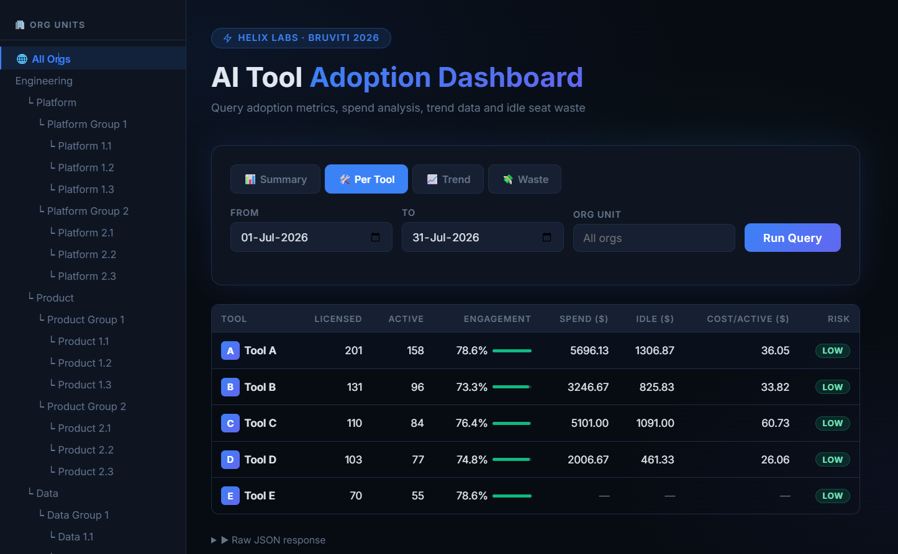
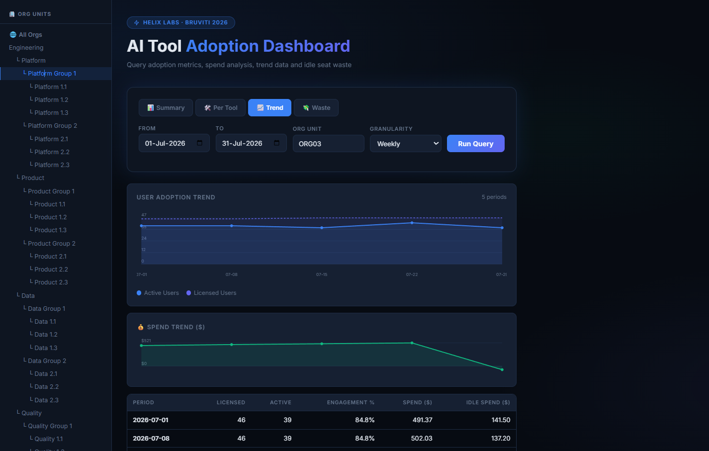
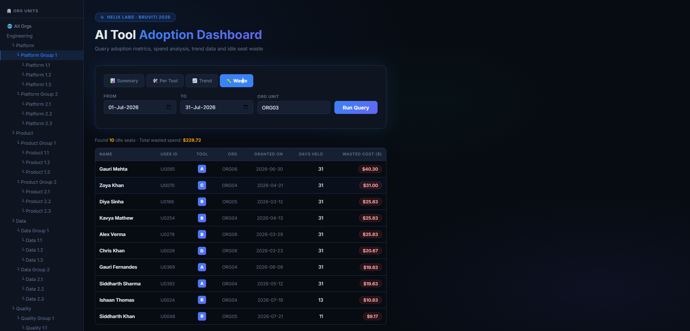

# Helix Labs — AI Tool Adoption & Spend Analytics Platform

> **Author:** Chandani Kumari  
> **Email:** [it.kumarichandani@gmail.com](mailto:it.kumarichandani@gmail.com)  
> **Challenge:** Bruviti 2026 — Use Case 4: AI Adoption Dashboard API  

---

## 📋 Table of Contents

1. [Executive Summary & Problem Statement](#executive-summary--problem-statement)
2. [Interactive Dashboard Walkthrough](#interactive-dashboard-walkthrough)
   - [Executive Summary & Global KPIs](#1-executive-summary--global-kpis)
   - [Tool-by-Tool Adoption & Renewal Risk](#2-tool-by-tool-adoption--renewal-risk)
   - [Time-Series Adoption & Spend Trends](#3-time-series-adoption--spend-trends)
   - [License Waste & Cost Optimization (Idle Seats)](#4-license-waste--cost-optimization-idle-seats)
3. [System Architecture & Data Flow](#system-architecture--data-flow)
4. [High-Precision Computation Engine](#high-precision-computation-engine)
5. [Data Cleaning, Quality Findings & Rules](#data-cleaning-quality-findings--rules)
6. [API Documentation: What Each API Does](#api-documentation-what-each-api-does)
   - [Overview & Status Codes](#overview--status-codes)
   - [1. `GET /api/summary` — Aggregate Adoption & Spend](#1-get-apisummary--aggregate-adoption--spend)
   - [2. `GET /api/tools` — Per-Tool Breakdown & Renewal Risk](#2-get-apitools--per-tool-breakdown--renewal-risk)
   - [3. `GET /api/idle-seats` — Inactive Seats & Waste Identification](#3-get-apiidle-seats--inactive-seats--waste-identification)
   - [4. `GET /api/trend` — Time-Series Adoption & Spend Slicing](#4-get-apitrend--time-series-adoption--spend-slicing)
   - [5. `GET /api/orgs` — Organizational Unit Hierarchy](#5-get-apiorgs--organizational-unit-hierarchy)
   - [6. `GET /health` — Service Liveness Probe](#6-get-health--service-liveness-probe)
7. [Getting Started & Local Setup](#getting-started--local-setup)
8. [Automated Test Suite & Quality Assurance](#automated-test-suite--quality-assurance)
9. [Project Directory Structure](#project-directory-structure)

---

## Executive Summary & Problem Statement

Modern software engineering organizations invest hundreds of thousands of dollars into AI coding tools (e.g., GitHub Copilot, Cursor, JetBrains AI, Claude Code). However, engineering leaders and procurement managers face two critical challenges:

1. **Adoption Opacity:** Lack of visibility into which developers are actively using assigned AI licenses versus treating them as shelfware.
2. **Spend Wastage:** Inability to pinpoint idle seats, prorate partial license tenures accurately, and detect low-engagement tools before multimillion-dollar annual renewals.

**Helix Labs AI Tool Adoption Platform** is a zero-latency, production-grade analytics platform built on **FastAPI** with a vanilla modern single-page dashboard. It ingests identity, organizational hierarchy, license assignments, contract pricing tiers, and vendor activity telemetry, delivering sub-millisecond adoption insights, financial waste calculations, and renewal risk scoring across arbitrary date windows and organizational subtrees.

---

## Interactive Dashboard Walkthrough

The platform features an embedded single-page responsive UI served directly at `GET /` with real-time reactive filters, interactive SVG trend charts, hierarchical org filtering, and raw JSON inspectors.

### 1. Executive Summary & Global KPIs

The Summary view computes high-level organizational health metrics across the selected date window and organizational department:

- **Licensed Users:** Unique engineers holding at least one seat during the period.
- **Active Users:** Engineers who performed qualifying AI operations (`chat`, `completion`, `agent`) while holding a valid seat.
- **Engagement Rate:** Active users as a percentage of licensed users (active ÷ licensed × 100).
- **Total Spend:** Total prorated license expenditures across all priced tools.
- **Idle Spend:** Financial waste incurred from seats held without any qualifying activity.



---

### 2. Tool-by-Tool Adoption & Renewal Risk

The Per-Tool breakdown provides granular unit economics for every vendor tool (`Tool A` through `Tool E`):

- **Adoption & Engagement:** Licensed and active user breakdown with visual progress indicators.

- **Financial Attribution:** Spend, idle spend, and average cost per active developer (spend ÷ active_users).
- **Graceful Unpriced Handling:** As per Appendix P specifications, unpriced tools (such as `Tool E`) properly display user adoption while reporting spend and unit economics as `—` (JSON `null`) rather than misleading zeros.
- **Renewal Risk Categorization:**
  - 🔴 **High Risk:** Engagement `< 40%` — immediate intervention or cancellation candidate.
  - 🟡 **Medium Risk:** Engagement `40% – 69.9%` — potential under-utilization.
  - 🟢 **Low Risk:** Engagement `≥ 70%` — healthy developer adoption.



---

### 3. Time-Series Adoption & Spend Trends

The Trend view enables finance and engineering leadership to track behavioral shifts and spending dynamics over time:

- **Adaptive Granularity:** Slice any date window into weekly (7-day intervals) or daily sub-periods.
- **Interactive SVG Visualizations:**
  - User Adoption Trend: Tracks active user trajectories against the licensed baseline.
  - Spend Trajectory: Highlights weekly/daily spending fluctuations and seasonal drops.
- **Period-by-Period Audit Table:** Tabular view of licensed users, active users, engagement %, spend, and idle waste for each time slice.



---

### 4. License Waste & Cost Optimization (Idle Seats)

The Waste view provides procurement teams with an actionable deprovisioning priority list:

- **Dollar-Weighted Ranking:** Identifies every held seat that logged zero qualifying activity during the query window, sorted by wasted cost in descending order.
- **Developer Attribution:** Displays the employee name, user ID, tool, department, grant date, and active days held.
- **Immediate ROI:** Quantifies exact cost-recovery opportunities by deprovisioning inactive seats.



---

## System Architecture & Data Flow

The system is designed for maximum speed, determinism, and zero external runtime dependencies.

```
┌─────────────────────────────────────────────────────────────────────────────┐
│                             Raw Data Ingestion                              │
│  people.csv  ·  org_units.csv  ·  seats.csv  ·  price_list.csv  ·  events  │
└──────────────────────────────────────┬──────────────────────────────────────┘
                                       │ Startup (lifespan)
                                       ▼
┌─────────────────────────────────────────────────────────────────────────────┐
│                          app/clean.py (Normalizer)                          │
│  - Deduplicates events (content-hash)                                       │
│  - Cleans org cycles, resolves recursive subtree sets                      │
│  - Converts multi-format timestamps to local IST ordinals                   │
│  - Builds [granted_on, revoked_on) half-open intervals                      │
│  - Preserves exact contract pricing via fractions.Fraction                  │
└──────────────────────────────────────┬──────────────────────────────────────┘
                                       │ Loaded once into in-memory CleanData
                                       ▼
┌─────────────────────────────────────────────────────────────────────────────┐
│                         app/metrics.py (Core Engine)                        │
│  - Exact rational arithmetic (zero intermediate rounding)                   │
│  - O(log N) bisect lookup for concurrent usage matching                     │
│  - Recursive org subtree filtering                                          │
│  - Renewal risk classification & idle waste ranking                         │
└───────────────────┬─────────────────────────────────────┬───────────────────┘
                    │                                     │
                    ▼                                     ▼
┌──────────────────────────────────────┐  ┌───────────────────────────────────┐
│         FastAPI HTTP Engine          │  │       Interactive Dashboard       │
│           (app/main.py)              │  │        (static/index.html)        │
│  - GET /health                       │  │  - Responsive Dark-Mode UI        │
│  - GET /api/summary                  │  │  - Interactive Org Hierarchy Tree │
│  - GET /api/tools                    │  │  - Embedded Dynamic SVG Charts    │
│  - GET /api/idle-seats               │  │  - Instant Query State Filtering  │
│  - GET /api/trend                    │  │  - Zero npm/node build overhead   │
│  - GET /api/orgs                     │  │                                   │
└──────────────────────────────────────┘  └───────────────────────────────────┘
```

### Key Architectural Strengths

1. **In-Memory Zero-Latency Execution:** Telemetry and identity datasets are parsed once during FastAPI application startup (`lifespan`). Queries execute against optimized Python dictionaries and sorted lists with zero database round-trips.
2. **Subtree-Set Org Resolution:** Department hierarchies can span arbitrary levels (`L1` to `L5`). At startup, `_org_user_sets()` precomputes transitive closures for every organization unit, allowing department filters to filter users in O(1) set-membership checks.
3. **Bisect-Accelerated Telemetry Verification:** Developer activity timestamps are mapped to integer calendar day ordinals. Testing if a user logged activity during their active seat tenure uses `bisect_left` in O(log K) time.

---

## High-Precision Computation Engine

Financial compliance requires eliminating floating-point rounding errors.

### 1. Exact Rational Arithmetic (`fractions.Fraction`)

- Floating-point representations (e.g. `0.1 + 0.2 != 0.3`) accumulate rounding errors across tens of thousands of developer-days.
- All seat costs, daily prorations, and aggregated spends are maintained as exact fractions:
  Daily rate = monthly_price_usd / 30
  Seat spend = Fraction(monthly_price_usd) × days_held_in_window / 30
- **Single-Point Rounding:** Intermediate sums are never truncated. Values are converted to `Decimal` and rounded exactly once when generating final responses using `ROUND_HALF_UP` to two decimal places for currency and one decimal place for percentages.

### 2. Calendar Semantics & Half-Open Intervals

- **30-Day Contract Convention:** In accordance with Appendix P, seat monthly prices cover exactly 30 days regardless of whether a month has 28, 30, or 31 days.
- **Revocation Boundary:** `revoked_on` represents the **first day without** the seat. The seat interval is strictly half-open:
  Interval = [granted_on, revoked_on)
  A seat granted on July 1 and revoked on July 10 is held for exactly 9 days (July 1 through July 9 inclusive).
- **Qualifying Usage Rule:** Activity only counts as valid usage if it occurs on a day when the developer held an active seat for that specific tool. Events outside the held interval are ignored.

---

## Data Cleaning, Quality Findings & Rules

The ingestion engine (`app/clean.py`) enforces resilient data quality rules without manual per-row patches, ensuring zero breakage on new grading data:

| # | Data Finding | Dataset Occurrence | Engineering Decision & Rule |
| --- | --- | --- | --- |
| **1** | **Unpriced Tool E** | `price_list.csv` | Tool E has blank pricing. Handled as unpriced; `spend`, `idle_spend`, and `cost_per_active` return `null`. Licensed/active adoption counts remain 100% functional. |
| **2** | **Duplicate Telemetry** | 250 duplicate rows in `activity_events.csv` | Content-hash deduplication removes redundant records without skewing active-day calculations. |
| **3** | **Foreign Users** | 40 event rows with missing IDs (`U9003`, `U9002`...) | Filtered out. The system reports strictly on company developers defined in `people.csv`. |
| **4** | **Unlicensed Usage** | 120 event-days for tools without a seat | Preserved in storage but excluded from adoption metrics. Usage requires concurrent seat ownership. |
| **5** | **Timezone Offsets** | Mixed timestamps (naive, UTC/Z, IST) | All timestamps normalized to local IST (`UTC+05:30`), the local timezone for Helix Labs' campuses (Bengaluru, Hyderabad, Pune). |
| **6** | **Organizational Cycles** | Parent-child pointer anomalies | Tree cycle detection breaks cyclic references and self-referencing parents to guarantee clean tree traversal. |
| **7** | **Multi-Format Dates** | ISO, European, alphanumeric dates | Universal date parser resolves `YYYY-MM-DD`, `DD/MM/YYYY`, `01-Jul-2026`, and Unix timestamps. |

---

## API Documentation: What Each API Does

Interactive Swagger documentation is available at `GET /docs` and ReDoc at `GET /redoc`.

### Overview & HTTP Status Codes

All API endpoints follow strict REST conventions and return JSON payloads:

| HTTP Status | Meaning | When it occurs |
|---|---|---|
| `200 OK` | Success | Query executed successfully and returned computed metrics. |
| `404 Not Found` | Resource Not Found | Specified `org` unit ID does not exist in `org_units.csv`. |
| `422 Unprocessable Entity` | Validation Error | Date format is invalid (not `YYYY-MM-DD`) or inverted window (`from > to`). |
| `503 Service Unavailable` | Not Ready | Application accessed before startup data ingestion is complete. |

---

### 1. `GET /api/summary` — Aggregate Adoption & Spend

#### What It Does:
Computes high-level adoption and financial figures across all tools for the specified date window and optional organization unit. If an `org` is specified, metrics recursively roll up across that unit and all of its subordinate teams.

#### Query Parameters:
| Parameter | Type | Required | Description |
|---|---|---|---|
| `from` | `string` | **Yes** | Start date (`YYYY-MM-DD`, inclusive). |
| `to` | `string` | **Yes** | End date (`YYYY-MM-DD`, inclusive). |
| `org` | `string` | No | Organization unit ID filter (e.g., `ORG05`, `ORG07`). |

#### Response Fields:
| Field | Type | Description |
|---|---|---|
| `licensed_users` | `integer` | Count of distinct employees who held at least one seat on at least one day during the window. |
| `active_users` | `integer` | Count of distinct employees who logged qualifying usage (`chat`, `completion`, `agent`) on a day they held an active seat. |
| `engagement_pct` | `float` | Percentage of licensed users who were active (active ÷ licensed × 100), rounded to 1 decimal place. |
| `spend` | `float` | Total spend across all priced tools held in the window, prorated at monthly_price / 30 × days_held (2 decimal places). |
| `idle_spend` | `float` | Total waste incurred by seats held with zero qualifying activity in the window (2 decimal places). |

#### Worked Example Query:
```http
GET /api/summary?from=2026-07-01&to=2026-07-30
```

#### Example Response (from Appendix P Worked Example):
```json
{
  "licensed_users": 2,
  "active_users": 1,
  "engagement_pct": 50.0,
  "spend": 38.5,
  "idle_spend": 19.5
}
```

*Derivation:*
- **P1 on Tool A** (USD 19/month, held all 30 days, used on July 5): Spend = USD 19.00, Idle = USD 0.00
- **P1 on Tool C** (USD 30/month, granted July 21 → held 10 days, not used): Spend = USD 10.00, Idle = USD 10.00
- **P2 on Tool A** (USD 19/month, revoked July 16 → held 15 days, not used): Spend = USD 9.50, Idle = USD 9.50
- **Total:** Licensed: `2`, Active: `1`, Engagement: `50.0%`, Spend: `38.5`, Idle: `19.5`.

---

### 2. `GET /api/tools` — Per-Tool Breakdown & Renewal Risk

#### What It Does:
Returns granular metrics for each vendor tool, guaranteed to appear in fixed order: `Tool A`, `Tool B`, `Tool C`, `Tool D`, `Tool E`. Unpriced tools (such as `Tool E`) gracefully report `null` for spend metrics while accurately reporting user adoption.

#### Query Parameters:
| Parameter | Type | Required | Description |
|---|---|---|---|
| `from` | `string` | **Yes** | Start date (`YYYY-MM-DD`, inclusive). |
| `to` | `string` | **Yes** | End date (`YYYY-MM-DD`, inclusive). |
| `org` | `string` | No | Organization unit ID filter. |

#### Response Fields (per tool item):
| Field | Type | Description |
|---|---|---|
| `tool` | `string` | Tool name (`"A"`, `"B"`, `"C"`, `"D"`, `"E"`). |
| `licensed_users` | `integer` | Count of distinct employees holding a seat for this tool during the window. |
| `active_users` | `integer` | Count of distinct employees with qualifying usage on this tool during the window. |
| `engagement_pct` | `float` | Active / Licensed × 100 (1 decimal place). |
| `spend` | `float \| null` | Prorated spend for this tool. Returns `null` if unpriced (`Tool E`). |
| `idle_spend` | `float \| null` | Spend wasted on inactive seats for this tool. Returns `null` if unpriced. |
| `cost_per_active` | `float \| null` | Unit cost per active user (spend ÷ active_users). Returns `null` if unpriced or no active users. |
| `renewal_risk` | `string` | Renewal risk classification: `"high"` (< 40%), `"medium"` (40-69.9%), `"low"` (>= 70%), or `"none"`. |

#### Example Query:
```http
GET /api/tools?from=2026-07-01&to=2026-07-31
```

#### Example Response:
```json
[
  {
    "tool": "A",
    "licensed_users": 201,
    "active_users": 158,
    "engagement_pct": 78.6,
    "spend": 5696.13,
    "idle_spend": 1306.87,
    "cost_per_active": 36.05,
    "renewal_risk": "low"
  },
  {
    "tool": "B",
    "licensed_users": 131,
    "active_users": 96,
    "engagement_pct": 73.3,
    "spend": 3246.67,
    "idle_spend": 825.83,
    "cost_per_active": 33.82,
    "renewal_risk": "low"
  },
  {
    "tool": "C",
    "licensed_users": 110,
    "active_users": 84,
    "engagement_pct": 76.4,
    "spend": 5101.00,
    "idle_spend": 1091.00,
    "cost_per_active": 60.73,
    "renewal_risk": "low"
  },
  {
    "tool": "D",
    "licensed_users": 103,
    "active_users": 77,
    "engagement_pct": 74.8,
    "spend": 2006.67,
    "idle_spend": 461.33,
    "cost_per_active": 26.06,
    "renewal_risk": "low"
  },
  {
    "tool": "E",
    "licensed_users": 70,
    "active_users": 55,
    "engagement_pct": 78.6,
    "spend": null,
    "idle_spend": null,
    "cost_per_active": null,
    "renewal_risk": "low"
  }
]
```

---

### 3. `GET /api/idle-seats` — Inactive Seats & Waste Identification

#### What It Does:
Returns every individual license seat held during the date window that registered **zero qualifying activity**, sorted in descending order by financial waste. This provides an immediate, actionable deprovisioning list for IT and finance leaders.

#### Query Parameters:
| Parameter | Type | Required | Description |
|---|---|---|---|
| `from` | `string` | **Yes** | Start date (`YYYY-MM-DD`, inclusive). |
| `to` | `string` | **Yes** | End date (`YYYY-MM-DD`, inclusive). |
| `org` | `string` | No | Organization unit ID filter. |

#### Response Fields (per idle seat item):
| Field | Type | Description |
|---|---|---|
| `user_id` | `string` | Employee user identifier (e.g., `"U0095"`). |
| `name` | `string` | Employee display name (e.g., `"Gauri Mehta"`). |
| `tool` | `string` | Tool identifier (`"A"`, `"B"`, `"C"`, `"D"`). Only priced tools are returned. |
| `org_unit` | `string` | Department / org unit ID where the developer is assigned. |
| `granted_on` | `string` | Date the seat license was initially assigned (`YYYY-MM-DD`). |
| `days_held` | `integer` | Total days the seat was active within the query window. |
| `cost` | `float` | Dollar waste incurred by this unused seat (monthly_price × days_held / 30). |

#### Example Query:
```http
GET /api/idle-seats?from=2026-07-01&to=2026-07-31&org=ORG03
```

#### Example Response:
```json
[
  {
    "user_id": "U0095",
    "name": "Gauri Mehta",
    "tool": "A",
    "org_unit": "ORG06",
    "granted_on": "2026-06-30",
    "days_held": 31,
    "cost": 40.30
  },
  {
    "user_id": "U0070",
    "name": "Zoya Khan",
    "tool": "C",
    "org_unit": "ORG04",
    "granted_on": "2026-04-21",
    "days_held": 31,
    "cost": 31.00
  }
]
```

---

### 4. `GET /api/trend` — Time-Series Adoption & Spend Slicing

#### What It Does:
Slices the specified date window into chronological sub-periods (weekly or daily) and computes adoption, spend, and idle waste for each slice. Powers time-series trend lines and period-by-period financial audits.

#### Query Parameters:
| Parameter | Type | Required | Description |
|---|---|---|---|
| `from` | `string` | **Yes** | Start date (`YYYY-MM-DD`, inclusive). |
| `to` | `string` | **Yes** | End date (`YYYY-MM-DD`, inclusive). |
| `granularity` | `string` | No | `"week"` (default, 7-day intervals) or `"day"` (1-day intervals). |
| `org` | `string` | No | Organization unit ID filter. |

#### Response Fields (per trend item):
Contains a `period` string (`YYYY-MM-DD`) indicating the slice start date, along with the standard summary fields: `licensed_users`, `active_users`, `engagement_pct`, `spend`, and `idle_spend`.

#### Example Query:
```http
GET /api/trend?from=2026-07-01&to=2026-07-31&granularity=week&org=ORG03
```

#### Example Response:
```json
[
  {
    "period": "2026-07-01",
    "licensed_users": 46,
    "active_users": 39,
    "engagement_pct": 84.8,
    "spend": 491.37,
    "idle_spend": 141.50
  },
  {
    "period": "2026-07-08",
    "licensed_users": 46,
    "active_users": 39,
    "engagement_pct": 84.8,
    "spend": 502.03,
    "idle_spend": 137.20
  }
]
```

---

### 5. `GET /api/orgs` — Organizational Unit Hierarchy

#### What It Does:
Returns the complete corporate hierarchy of organization units, including names, levels (`L1` to `L5`), and parent unit IDs. Used for departmental filtering and org tree navigation.

#### Query Parameters:
*None.*

#### Response Fields (per org item):
| Field | Type | Description |
|---|---|---|
| `org_unit_id` | `string` | Unique identifier for the organization unit (e.g., `"ORG01"`). |
| `parent_id` | `string \| null` | Parent organization unit ID (`null` for top-level root units). |
| `name` | `string` | Display name of the department/team (e.g., `"Platform Group 1"`). |
| `level` | `string` | Hierarchy level code (e.g., `"L1"`, `"L2"`, `"L3"`). |

#### Example Query:
```http
GET /api/orgs
```

#### Example Response:
```json
[
  {
    "org_unit_id": "ORG01",
    "parent_id": null,
    "name": "Engineering",
    "level": "L1"
  },
  {
    "org_unit_id": "ORG02",
    "parent_id": "ORG01",
    "name": "Platform",
    "level": "L2"
  }
]
```

---

### 6. `GET /health` — Service Liveness Probe

#### What It Does:
Health check endpoint used by orchestration tools, Docker, and Kubernetes. Confirms that all CSV datasets have loaded into memory and the service is ready to accept queries.

#### Response:
```json
{
  "status": "ok"
}
```

---

### 7. `GET /` — Interactive Dashboard UI

#### What It Does:
Serves the embedded dark-mode single-page dashboard application directly from `static/index.html` with zero external dependencies.

---

## Getting Started & Local Setup

### Prerequisites

- Python 3.10+
- pip

### 1. Installation

Clone the repository and install the lightweight dependencies:

```bash
pip install -r requirements.txt
```

### 2. Launch the Application

Run the Uvicorn ASGI server:

```bash
python -m uvicorn app.main:app --port 8000 --reload
```

Once started:

- 🌐 **Dashboard UI:** Open [http://localhost:8000](http://localhost:8000)
- 📖 **Swagger API Docs:** Open [http://localhost:8000/docs](http://localhost:8000/docs)
- 🩺 **Health Check:** Open [http://localhost:8000/health](http://localhost:8000/health)

### 3. Environment Variables

| Variable | Default | Description |
|---|---|---|
| `DATA_DIR` | `data` | Directory containing the input CSV exports (`people.csv`, `org_units.csv`, `seats.csv`, `price_list.csv`, `activity_events.csv`) |

---

## Automated Test Suite & Quality Assurance

The test suite contains **65 comprehensive automated tests** across 10 test categories. All tests run **100% offline** without any network calls or database dependencies.

Run the test suite:

```bash
python -m pytest tests/ -v
```

### Test Coverage Highlights

- **Appendix P Worked Example:** Strict numeric validation reproducing the exact values from the brief.
- **Seat Boundary Semantics:** Verifies `revoked_on` exclusive boundary conditions and active-seat tenure.
- **Telemetry Verification:** Ensures events without corresponding seats are disregarded.
- **Unpriced Handling:** Confirms null spend and unit economics for Tool E across all queries.
- **Subtree Aggregation:** Validates recursive organizational hierarchy filtering.
- **HTTP Contract Testing:** Exercises every endpoint path, parameter validation (`422`), and unknown entities (`404`).

---

## Project Directory Structure

```
.
├── app/
│   ├── __init__.py
│   ├── main.py             # FastAPI application, route handlers, lifespan loader
│   ├── clean.py            # CSV ingestion, data cleaning, date parsing, org hierarchy
│   └── metrics.py          # Exact rational math, adoption & spend metrics, idle seats, trends
├── static/
│   └── index.html          # Responsive single-page dashboard (HTML5, Vanilla CSS, JS)
├── tests/
│   └── test_all.py         # 65 automated offline test cases
├── Images/                 # Dashboard section screenshots (Summary, Per-Tool, Trend, Waste)
├── data/                   # Input CSV datasets
├── requirements.txt        # Production dependencies (fastapi, uvicorn, pytest, etc.)
├── README.md               # Complete project documentation & architectural guide
├── DATA.md                 # Detailed data quality findings & cleaning rules
├── NOTES.md                # Engineering decisions, trade-offs & design notes
└── AI.md                   # AI tooling usage log & co-pilot acknowledgments
```

---

*Developed by **Chandani Kumari** ([it.kumarichandani@gmail.com](mailto:it.kumarichandani@gmail.com)) for Bruviti 2026.*
